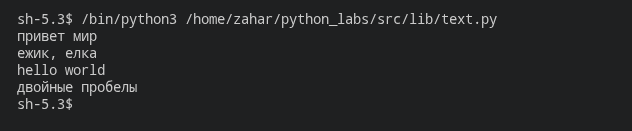
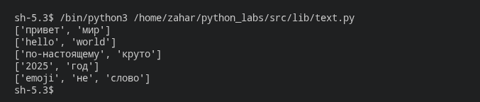
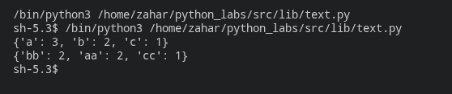
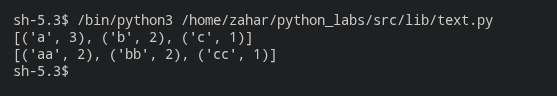
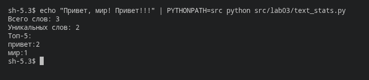

# ЛР3 - Тексты и частоты слов

### normalize

#### Код

```python
import re

def normalize(text: str, *, casefold: bool = True, yo2e: bool = True) -> str:
    if casefold == True: 
        text = text.casefold()
    else:
        text = text.lower()
    
    if yo2e == True:
        text = text.replace("Ё", "Е").replace("ё","е")

    text = re.sub(r"\s+", " ", text).strip()

    return text
```

#### Проверочные строки

```python
test_array_1 = [
    "ПрИвЕт\nМИр\t",
    "ёжик, Ёлка",
    "Hello\r\nWorld",
    "  двойные   пробелы  "
]
```

#### Вывод



#### Краткое описание

Функция приводит текст к нижнему регистру, по умолчанию используя `casefold()`, заменяет `ё` на `е`, объединяет последовательности пробельных символов в один пробел и убирает пробелы по краям. При `casefold=False` используется `lower()`, а при `yo2e=False` замена `ё` отключается.

### tokenize

#### Код

```python
import re

def tokenize(text: str) -> list[str]:
    words = re.findall(r"\w+(?:-\w+)*", text)
    return words 
```

#### Проверочные строки

```python
test_array_2 = [
    "ПрИвЕт\nМИр\t",
    "hello,world!!!",
    "по-настоящему круто",
    "2025 год",
    "emoji 😀 не слово"
]
```

#### Вывод



#### Краткое описание

Функция выделяет токены с помощью регулярного выражения `\w+(?:-\w+)*`. Буквы, цифры и символ подчёркивания входят в токены, а слова с дефисами сохраняются целиком. Знаки препинания и эмодзи разделяют токены и не попадают в результат. Для проверки строки сначала обрабатываются функцией `normalize()`.

### count_freq

#### Код

```python
def count_freq(tokens: list[str]) -> dict[str, int]:
    freq = {}
    for word in tokens:
        if word in freq:
            freq[word] += 1
        else:
            freq[word] = 1
    return dict(sorted(freq.items()))
```

#### Проверочные списки

```python
test_array_3 = [
    ["a","b","a","c","b","a"],
    ["bb","aa","bb","aa","cc"]
]
```

#### Вывод



#### Краткое описание

Функция подсчитывает количество вхождений каждого токена и возвращает словарь, в котором ключ — токен, а значение — число его повторений. Ключи словаря располагаются в алфавитном порядке. Для пустого списка возвращается пустой словарь.

### top_n

#### Код

```python
def top_n(freq: dict[str, int], n: int = 5) -> list[tuple[str, int]]:
    words = list(freq.items())
    words = sorted(words, key=lambda x: (-x[1], x[0]))
    return words[:n]
```

#### Проверочные списки

```python
test_array_4 = [
    ["a","b","a","c","b","a"],
    ["bb","aa","bb","aa","cc"]
]
```

#### Вывод



#### Краткое описание

Функция сортирует пары «слово — количество» по убыванию частоты. При одинаковой частоте слова располагаются в алфавитном порядке. Возвращаются первые `n` пар, по умолчанию — пять. Для проверки списки токенов сначала преобразуются в словари функцией `count_freq()`.

### Код

```python
from lib.text import normalize, tokenize, count_freq, top_n


def main():
    text = input()
    text = normalize(text)
    tokens = tokenize(text)
    freq = count_freq(tokens)
    top = top_n(freq, 5)

    print(f"Всего слов: {len(tokens)}")
    print(f"Уникальных слов: {len(freq)}")
    print("Топ-5:")

    for word, count in top:
        print(f"{word}:{count}")


if __name__ == "__main__":
    main()
```

### Проверочная строка

```text
Привет, мир! Привет!!!
```

### Запуск

Из корня проекта:

```bash
echo "Привет, мир! Привет!!!" | PYTHONPATH=src python src/lab03/text_stats.py
```

### Вывод



### Краткое описание

Программа считывает одну строку, нормализует её, выделяет токены и подсчитывает их частоты с помощью функций из `lib.text`. Затем она выводит общее количество слов, количество уникальных слов и пять самых частых слов в формате `слово:количество`. Если уникальных слов меньше пяти, выводятся все найденные слова.
