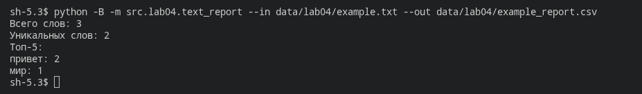
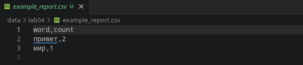
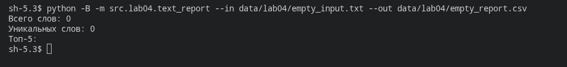
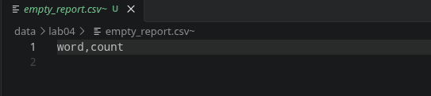
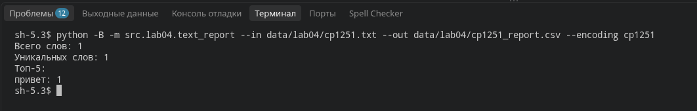
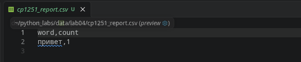
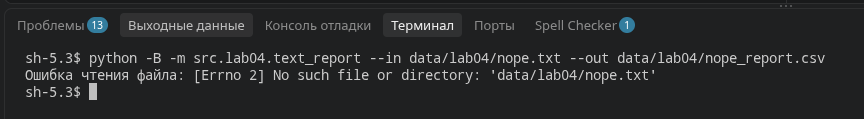

# Lab04 — Файлы: TXT/CSV и отчёты по текстовой статистике

## Код функций

### io_txt_csv.py

```python
import csv

from pathlib import Path

from typing import Iterable, Sequence

def read_text(path: str | Path, encoding: str = "utf-8") -> str:
    '''
    ...
    '''
    p = Path(path)
    return p.read_text(encoding=encoding)

def ensure_parent_dir(path: str | Path) -> None:
    '''
    ...
    '''
    Path(path).parent.mkdir(parents=True, exist_ok=True)

def write_csv(rows: list[tuple | list], path: str | Path, header: tuple[str, ...] | None = None) -> None:
    '''
    ...
    '''
    p = Path(path)
    rows = list(rows)

    if len(rows) != 0:
        len1 = len(rows[0])
        for i in rows:
            if len(i) != len1:
                raise ValueError('Все строки должны иметь одинаковую длину')

    ensure_parent_dir(path)
    
    with p.open("w", newline="", encoding="utf-8") as f:
        w = csv.writer(f)
        if header is not None:
            w.writerow(header)
        for r in rows:
            w.writerow(r)
```

### text_report.py

```python
from src.lib.text import normalize, tokenize, count_freq, top_n

from src.lab04.io_txt_csv import read_text, write_csv

import argparse

import csv

from pathlib import Path

def get_frequencies(text: str) -> dict[str, int]:
    """Нормализует текст и подсчитывает частоты слов."""
    text = normalize(text)
    words = tokenize(text)
    freq = count_freq(words)
    return freq

def sort_frequencies(freq: dict[str, int]) -> list[tuple[str, int]]:
    """Сортирует слова по частоте и алфавиту."""
    return sorted(freq.items(), key=lambda item: (-item[1], item[0]))

def main():
    parser = argparse.ArgumentParser(
        description="Создание отчёта о частоте слов"
    )

    parser.add_argument("--in", dest="input_path", default="data/input.txt")
    parser.add_argument("--out", default="data/report.csv")
    parser.add_argument("--encoding", default="utf-8")

    args = parser.parse_args()

    try:
        text = read_text(args.input_path, encoding=args.encoding)
    except (OSError, UnicodeError) as error:
        print(f"Ошибка чтения файла: {error}")
        return

    freq = get_frequencies(text)
    sorted_words = sort_frequencies(freq)

    try:
        write_csv(sorted_words, args.out, header=("word", "count"))
    except OSError as error:
        print(f"Ошибка записи файла: {error}")
        return

    print(f"Всего слов: {sum(freq.values())}")
    print(f"Уникальных слов: {len(freq)}")
    print("Топ-5:")

    for word, count in top_n(freq, 5):
        print(f"{word}: {count}")
```

## Состав лабораторной работы
- `src/lab04/io_txt_csv.py` — чтение текстовых данных и сохранение таблиц через `read_text` и `write_csv`
- `src/lab04/text_report.py` — обработка текста и формирование отчёта о повторениях слов
- `src/lib/text.py` — функции обработки текста из ЛР3: `normalize`, `tokenize`, `count_freq`, `top_n`
- `data/lab04/input.txt` — основной текст для анализа в UTF-8
- `data/lab04/a.txt` — `Привет мир` (данные для задания со звёздочкой)
- `data/lab04/b.txt` — `Привет, привет!` (данные для задания со звёздочкой)
- Результаты в CSV и вспомогательные входные файлы появляются при выполнении примеров. Правила `.gitignore` исключают их из репозитория.

---

## Как запустить программу
Перед выполнением команд нужно перейти в корневую папку `python_labs`.

```bash
# читает data/lab04/input.txt, пишет data/lab04/report.csv
python -B -m src.lab04.text_report --in data/lab04/input.txt --out data/lab04/report.csv

# свой входной и выходной файл
python -B -m src.lab04.text_report --in data/lab04/input.txt --out data/lab04/out.csv

# файл в другой кодировке
python -B -m src.lab04.text_report --in data/lab04/cp1251.txt --out data/lab04/cp1251_report.csv --encoding cp1251
```

| Аргумент | Стандартное значение | Для чего используется |
|---|---|---|
| `--in` | `data/input.txt` | путь к тексту для анализа |
| `--out` | `data/report.csv` | путь сохранения CSV |
| `--encoding` | `utf-8` | кодировка читаемого текста |

В примерах указаны полные относительные пути к учебным данным: они размещены в `data/lab04/`, тогда как программа по умолчанию обращается к `data/`. Для проверки Windows-1251 сначала создаётся отдельный файл — команда приведена в разделе C.

В CSV записываются два столбца: `word` (слово) и `count` (число повторений). Сначала идут наиболее частые слова; одинаковые частоты упорядочиваются по алфавиту.

---

## Чтение текста в разных кодировках
Без дополнительных настроек программа ожидает текст в **UTF-8**.
Для другого формата хранения символов используется аргумент `--encoding`. Например, Windows-1251 выбирается через `--encoding cp1251`. При вызове функции напрямую указывается `read_text(path, encoding="cp1251")`.
Если выбранная кодировка не позволяет прочитать байты файла, `read_text` поднимает `UnicodeDecodeError`. В скрипте эта ошибка обрабатывается сообщением `Ошибка чтения файла: ...`.
Кодировка результатов фиксирована: CSV сохраняется в **UTF-8**, независимо от кодировки исходного текста.

---

## Особые ситуации при работе с файлами
- **В тексте нет данных.** В CSV записывается одна строка `word,count`. Счётчики в терминале равны нулю, список частых слов пуст.
- **Указан несуществующий путь.** После сообщения `Ошибка чтения файла: ...` обработка прекращается. Выходной файл не создаётся, ранее сохранённый отчёт остаётся на месте.
- **Большой объём текста.** Согласно условию, содержимое загружается в память целиком. Для больших файлов на практике предпочтительнее построчная обработка.
- **Запись CSV.** Если `rows` пуст и `header=None`, результатом будет пустой файл. Если заголовок задан, сохраняется только он. Несовпадение количества элементов в строках данных приводит к `ValueError`.

---

## Проверка работы

### A. Подсчёт слов в обычном тексте
Для анализа используется строка `Привет, мир! Привет!!!`. Команда копирования создаёт тестовый файл с содержимым основного `input.txt`, после чего запускается подсчёт:

```bash
cp data/lab04/input.txt data/lab04/example.txt
python -B -m src.lab04.text_report --in data/lab04/example.txt --out data/lab04/example_report.csv
```

Результат в терминале:



Сохранённый CSV:



---

### B. Обработка пустого входа
Отдельный файл `data/lab04/empty_input.txt` создаётся без содержимого. Это позволяет проверить пустой ввод, сохранив основной текст в `input.txt`.

```bash
printf '' > data/lab04/empty_input.txt
python -B -m src.lab04.text_report --in data/lab04/empty_input.txt --out data/lab04/empty_report.csv
```

Результат в терминале:



Сохранённый CSV:



---

### C. Чтение Windows-1251
Слово `Привет` сохраняется в `data/lab04/cp1251.txt` в кодировке cp1251. При запуске та же кодировка передаётся программе:

```bash
printf 'Привет' | iconv -f UTF-8 -t CP1251 > data/lab04/cp1251.txt
python -B -m src.lab04.text_report --in data/lab04/cp1251.txt --out data/lab04/cp1251_report.csv --encoding cp1251
```

Результат в терминале:



Сохранённый CSV:



---

### Проверка отсутствующего файла

```bash
python -B -m src.lab04.text_report --in data/lab04/nope.txt --out data/lab04/nope_report.csv
```




---


