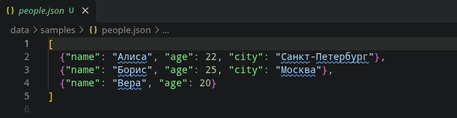
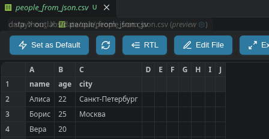
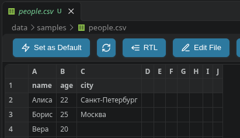
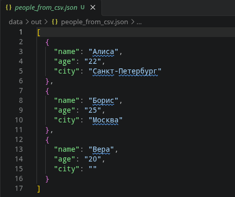
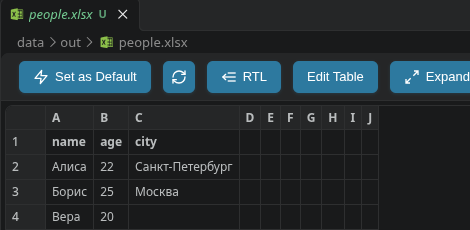
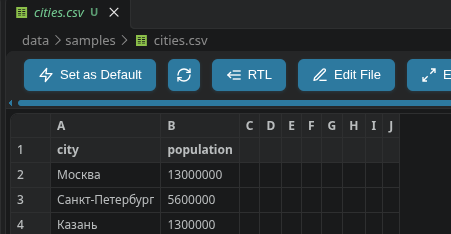
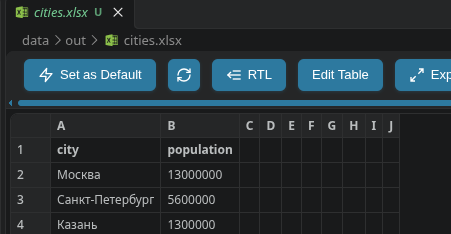

# ЛР5 — JSON и конвертации (JSON ↔ CSV, CSV → XLSX)

## Задание A — JSON ↔ CSV

### json_to_csv

```python
def json_to_csv(json_path: str, csv_path: str) -> None:
    """Преобразует список словарей из JSON в CSV."""
    p = Path(json_path)
    out = Path(csv_path)
    if p.suffix.lower() != '.json' or out.suffix.lower() != '.csv':
        raise ValueError('Нужны файлы JSON и CSV')

    with p.open(encoding='utf-8') as f:
        try:
            data = json.load(f)
        except json.JSONDecodeError:
            raise ValueError('Неверный или пустой JSON') from None

    if not isinstance(data, list) or not data:
        raise ValueError('Пустой JSON или неподдерживаемая структура')

    header = []
    for row in data:
        if not isinstance(row, dict):
            raise ValueError('JSON должен содержать список словарей')
        for key, value in row.items():
            if not key.strip():
                raise ValueError('Название поля не должно быть пустым')
            if isinstance(value, (dict, list)):
                raise ValueError('Вложенные объекты и списки не поддерживаются')
            if key not in header:
                header.append(key)
    if not header:
        raise ValueError('В JSON нет полей')

    out.parent.mkdir(parents=True, exist_ok=True)
    with out.open('w', encoding='utf-8', newline='') as f:
        writer = csv.DictWriter(f, fieldnames=header)
        writer.writeheader()
        writer.writerows(data)
```

Функция проверяет расширения, читает JSON через `json.load` и проверяет структуру: нужен непустой список словарей. Затем собирает названия колонок в порядке первого появления ключей. `csv.DictWriter` записывает заголовок и все строки.

Пример входа:

```json
[
  {"name": "Алиса", "age": 22, "city": "Санкт-Петербург"},
  {"name": "Борис", "age": 25, "city": "Москва"},
  {"name": "Вера", "age": 20}
]
```

Результат:

```csv
name,age,city
Алиса,22,Санкт-Петербург
Борис,25,Москва
Вера,20,
```

У Веры нет города, поэтому последняя ячейка пустая. Если новый ключ появится во втором или следующем объекте, он тоже попадёт в заголовок. Вложенные списки и словари не поддерживаются. Значение `null` записывается как пустая ячейка.

### read_csv и csv_to_json

```python
def read_csv(csv_path: str) -> list[list[str]]:
    """Читает CSV и проверяет заголовок и длину строк."""
    p = Path(csv_path)
    if p.suffix.lower() != '.csv':
        raise ValueError('Нужен CSV файл')

    with p.open(encoding='utf-8', newline='') as f:
        try:
            rows = list(csv.reader(f, strict=True))
        except csv.Error:
            raise ValueError('Неверный формат CSV') from None

    if not rows or not rows[0] or not any(rows[0]):
        raise ValueError('Пустой CSV или нет заголовка')
    header = rows[0]
    if any(not name.strip() for name in header) or len(set(header)) != len(header):
        raise ValueError('Заголовки должны быть непустыми и разными')
    for row in rows[1:]:
        if len(row) != len(header):
            raise ValueError('Все строки должны иметь одинаковую длину')
    if len(rows) < 2:
        raise ValueError('CSV-файл не содержит данных')
    return rows


def csv_to_json(csv_path: str, json_path: str) -> None:
    """Сохраняет строки CSV как список словарей в JSON."""
    out = Path(json_path)
    if out.suffix.lower() != '.json':
        raise ValueError('Нужен выходной файл JSON')
    rows = read_csv(csv_path)
    data = []
    for row in rows[1:]:
        data.append(dict(zip(rows[0], row)))

    out.parent.mkdir(parents=True, exist_ok=True)
    with out.open('w', encoding='utf-8') as f:
        json.dump(data, f, ensure_ascii=False, indent=2)
```

`read_csv` читает таблицу через `csv.reader` и проверяет заголовок, наличие записей и одинаковую длину строк. Эту функцию использует и конвертер XLSX.

В `csv_to_json` первая строка становится ключами словарей. `dict(zip(rows[0], row))` сопоставляет заголовки ячейкам очередной строки. Полученные словари записываются списком через `json.dump(data, f, ensure_ascii=False, indent=2)`.

Например, первая запись результата:

```json
{"name": "Алиса", "age": "22", "city": "Санкт-Петербург"}
```

Возраст стал строкой: CSV не хранит информацию о типах. Обратная конвертация сохраняет текст таблицы, но не восстанавливает типы исходного JSON.


## Задание B — CSV → XLSX

```python
def csv_to_xlsx(csv_path: str, xlsx_path: str) -> None:
    """Переносит CSV на лист Sheet1 и подбирает ширину колонок."""
    out = Path(xlsx_path)
    if out.suffix.lower() != '.xlsx':
        raise ValueError('Нужен выходной файл XLSX')
    rows = read_csv(csv_path)

    wb = Workbook()
    ws = wb.active
    ws.title = 'Sheet1'
    for row in rows:
        ws.append(row)
        # CSV хранит текст: строки с = тоже остаются текстом, а не формулами.
        for cell in ws[ws.max_row]:
            cell.data_type = 's'

    for i in range(len(rows[0])):
        width = 8
        for row in rows:
            width = max(width, len(row[i]) + 2)
        column = get_column_letter(i + 1)
        ws.column_dimensions[column].width = width

    out.parent.mkdir(parents=True, exist_ok=True)
    wb.save(out)
    wb.close()
```

Функция читает проверенную таблицу через `read_csv`, создаёт книгу `Workbook()` и задаёт первому листу имя `Sheet1`. `ws.append(row)` переносит строки на лист. Ячейки сохраняются как текст, в том числе значения, начинающиеся с `=`.

Для каждого столбца определяется максимальная длина содержимого, включая заголовок. Ширина равна этой длине плюс 2, но не меньше 8. `get_column_letter` переводит номер столбца в букву, а `wb.save` сохраняет книгу.

```bash
python -c "from src.lab05.csv_xlsx import csv_to_xlsx; csv_to_xlsx('data/samples/cities.csv', 'data/out/example.xlsx')"
```

Используется одна внешняя библиотека — `openpyxl`. Для JSON и CSV достаточно стандартной библиотеки. Файл называется `csv_xlsx.py`, согласно структуре задания.

## Форматы и ошибки

Все текстовые файлы используют UTF-8. Разделитель CSV — запятая; значения с запятыми и переносами строк заключаются в кавычки средствами модуля `csv`. Для CSV используется `newline=''`. Первая строка считается заголовком: без известной схемы нельзя определить, является ли она строкой данных.

| Ситуация | Результат |
|---|---|
| Нет входного файла с правильным расширением | `FileNotFoundError` |
| Неверное расширение входа или результата | `ValueError` |
| Пустой или синтаксически неверный JSON | `ValueError` |
| JSON не является непустым списком словарей | `ValueError` |
| Нет полей, пустое имя поля или вложенные значения JSON | `ValueError` |
| Пустой CSV или только заголовок | `ValueError` |
| Пустые или повторяющиеся заголовки CSV | `ValueError` |
| Разное число ячеек в строках или нарушены кавычки | `ValueError` |

## Проверка

### 1. JSON → CSV

Исходный файл `data/samples/people.json` содержит три словаря. У Веры поле `city` отсутствует.



Результат — `data/out/people_from_json.csv`: заголовок `name,age,city` и три записи. Отсутствующий город записан как пустая ячейка.



### 2. CSV → JSON

Исходный файл `data/samples/people.csv` содержит заголовок и три записи.



Результат — `data/out/people_from_csv.json`: три словаря с ключами `name`, `age`, `city`. Все значения сохраняются строками: например, возраст — `"22"`. Пустая ячейка города становится `"city": ""`.



### 3. CSV → XLSX

Из `data/samples/people.csv`, показанного выше, получается `data/out/people.xlsx`. Заголовки и три записи перенесены в книгу.



Дополнительный пример — исходный файл `data/samples/cities.csv` с названиями городов и численностью населения.



Результат — `data/out/cities.xlsx`. На скриншоте файл открыт в редакторе таблиц: заголовки и три записи сохранены в XLSX.



Для `people.xlsx` программно проверены лист `Sheet1`, четыре строки с заголовком и три столбца шириной 8, 8 и 17. Для `cities.xlsx` — четыре строки с заголовком и два столбца.
